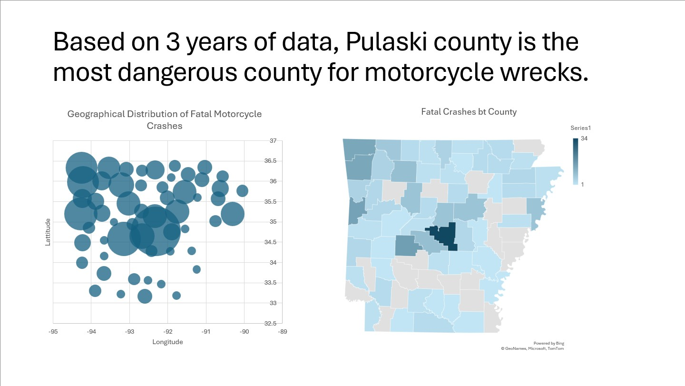
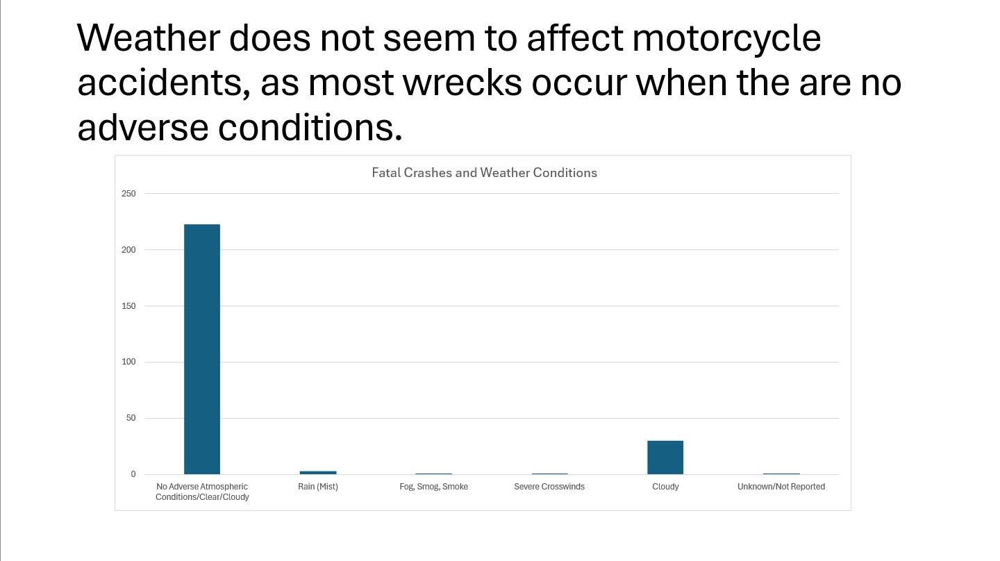
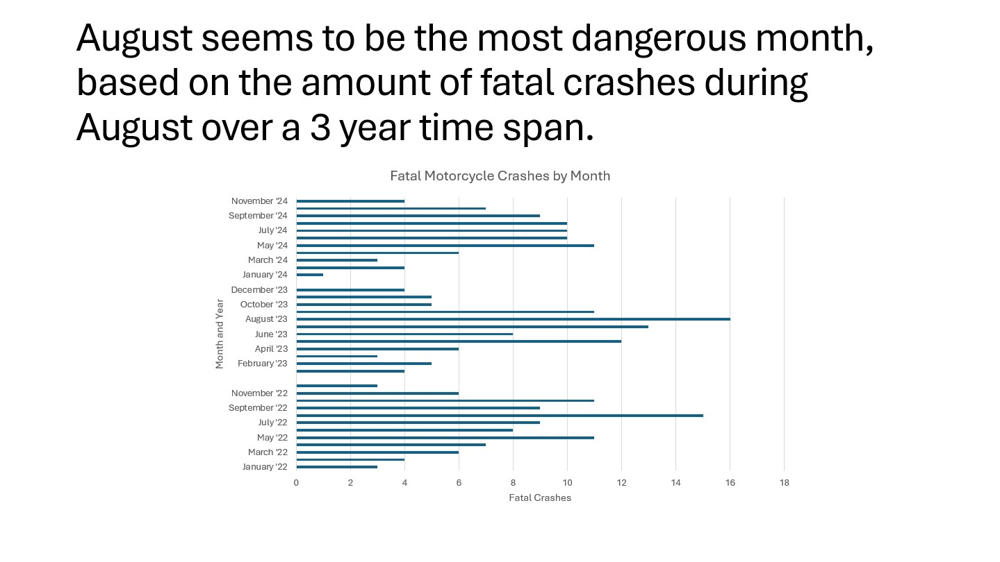
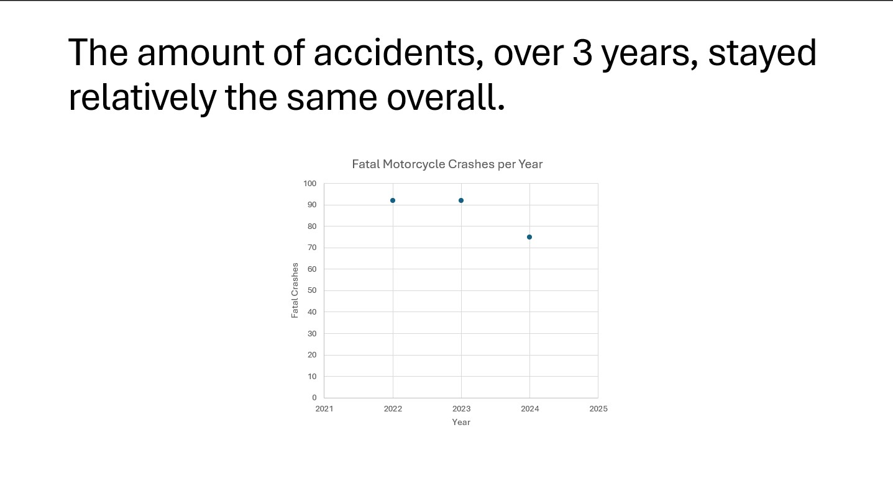

Portfolio Links

[jw340.github.io](jw340.github.io)

[Daniel-Baran773.github.io](Daniel-Baran773.github.io)

[sidneyn7.github.io](sidneyn7.github.io)

[josh-Castenada.github.io](josh-Castenada.github.io)

[jakebriseno.github.io](jakebriseno.github.io)

[kevinjacob077.github.io](kevinjacob077.github.io)

What is the most dangerous county for motorcycles? The most dangerous county was determined by the amount of fatal wrecks over the past 3 years. After cleaning the table to only contain the relevant columns. After creating the scatter plot using the coordinates of the counties, we created the second chart to better represent the counties.

How does weather affect crash rates? The most dangerous weather condition was determined by how many fatal wrecks occured during. We first cleaned the table to only include relevant information, then created a second table which counted the amount of fatal motorcycles wrecks for each weather condition.

Which month is the most dangerous for motorcycle wrecks? The most dangerous month was determined by counting the amount of fatal wrecks for each month each year. To create this bar chart we created a table which counted the amount of fatal crashes for each month and year.

Over 3 years, did the amount of fatal crashes increase? To determine the answer we decided to count the amount of fatal crashes for each year. First we cleaned and sorted the data based on year. Next we created a table that counted the total amount of fatal crashes per year.
